# Buderus-Brauchwasser-Wärmepumpe – Heizstab per Home Assistant

Ein kleiner **Servo-Switch** für das Touch-Bedienfeld einer Buderus-Brauchwasser-Wärmepumpe (WPT200 …): Ein Micro-Servo mit gedrucktem Finger drückt auf Befehl aus **Home Assistant** die Taste am Gerät – so lässt sich der interne **Heizstab** gezielt einschalten, z. B. wenn die Photovoltaik gerade Überschuss liefert.

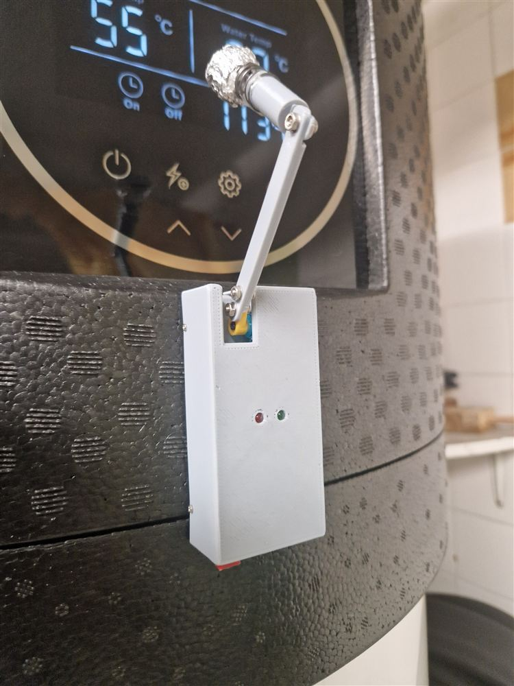

▶️ **Video:** [Servo-Switch in Aktion (YouTube Shorts)](https://www.youtube.com/shorts/Rg_nWFymjVo)

## Das Problem

Die Wärmepumpe ist „Photovoltaik-ready“. In der Praxis heißt das nur: Wird der PV-Kontakt geschlossen, erhöht sie die Soll-Temperatur auf einen eingestellten Wert (hier 65 °C). Den **Heizstab** schaltet sie darüber nicht ein – den nutzt sie nur, wenn die Außentemperatur zu niedrig ist oder zur Desinfektion. Mehr dazu im [Heizungsforum](https://www.heizungsforum.de/threads/waermepumpe-buderus-wpt200-4-as-informationen-zur-pv-unterstuetzung.24083/).

## Die Lösung

Statt in die Elektronik einzugreifen, drückt ein Servo die Taste am Bedienfeld – genau wie ein Finger:

- ein **Wemos D1 mini** mit ESPHome hängt im WLAN und erscheint in Home Assistant als Schalter,
- der **Servo** schwenkt einen gedruckten Finger mit gefederter Tastfläche auf die Taste und wieder zurück,
- die Tastfläche ist mit **Alufolie** bezogen, damit das kapazitive Touch-Feld sie als Finger erkennt,
- eine **rote LED** leuchtet, solange der Ablauf läuft.

## Bilder

| | | |
|---|---|---|
| 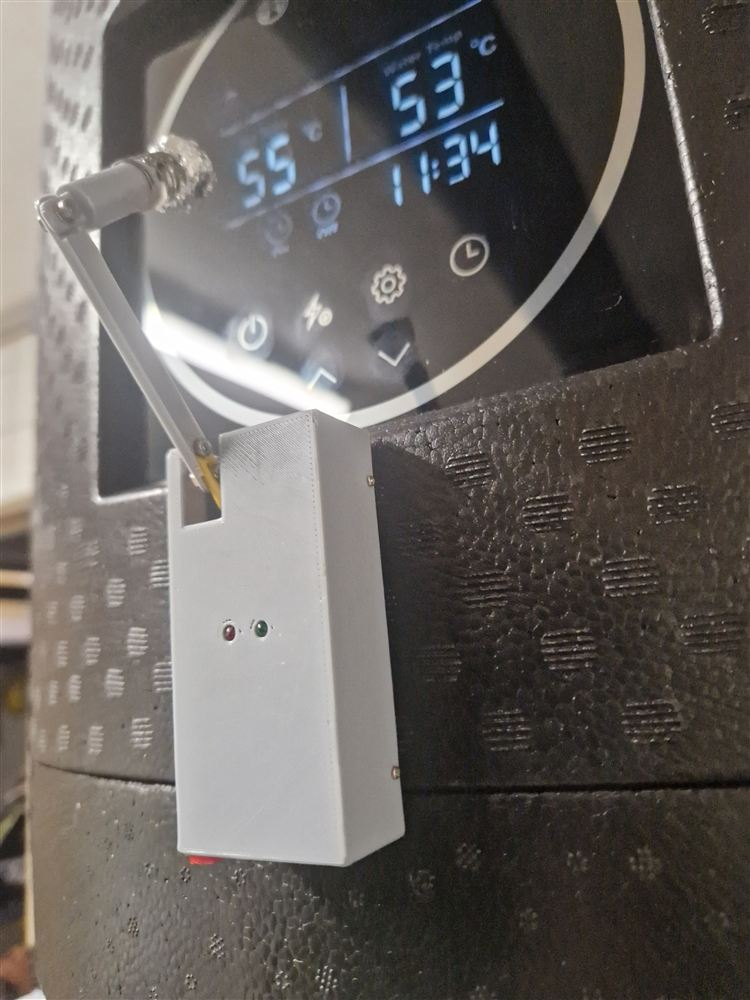 | 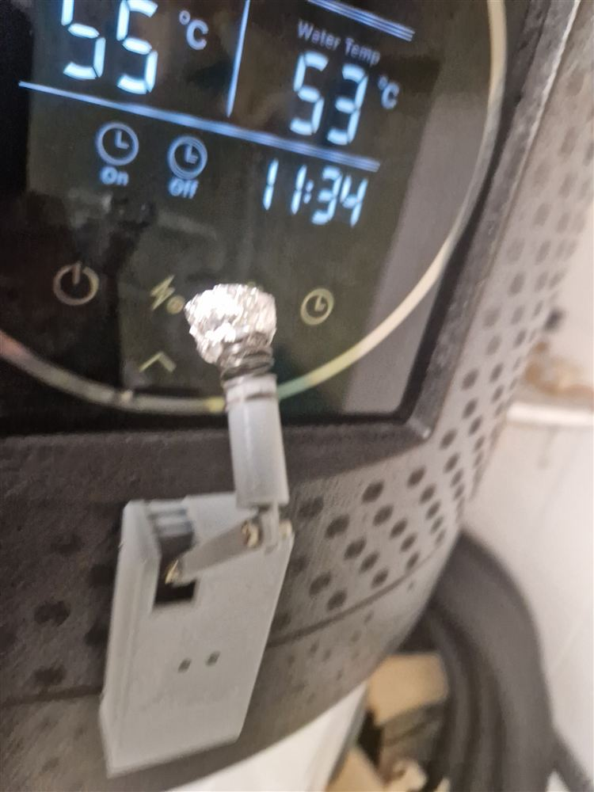 | 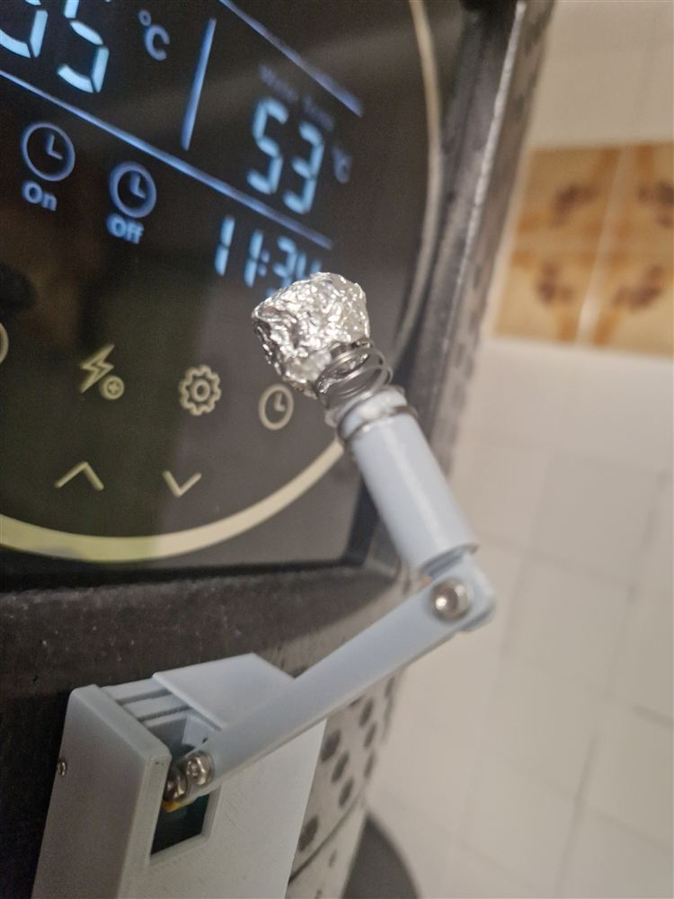 |
| 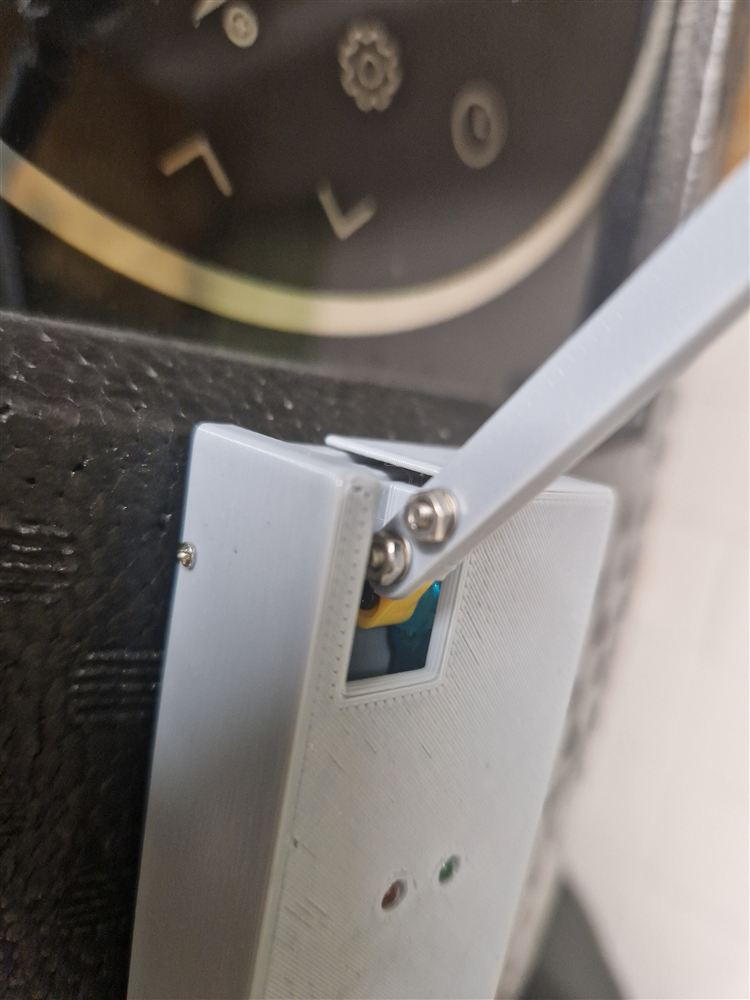 | 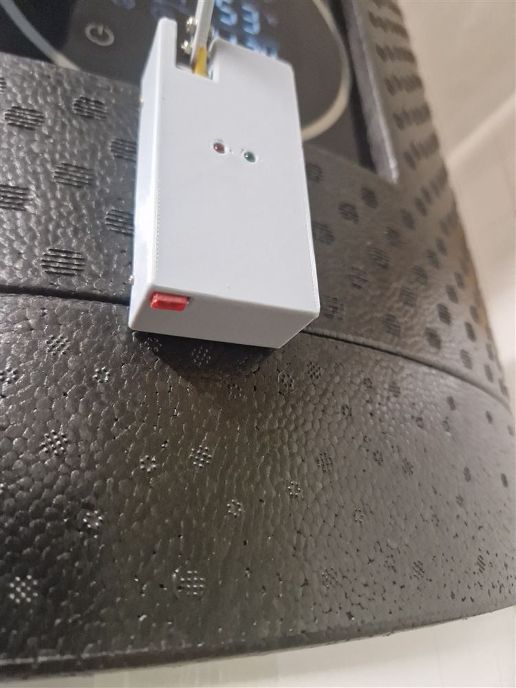 | 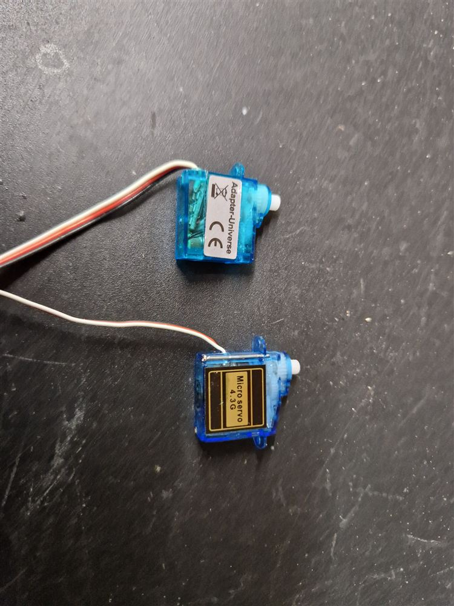 |
| 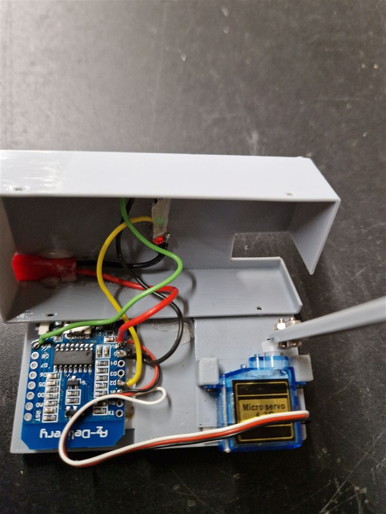 | 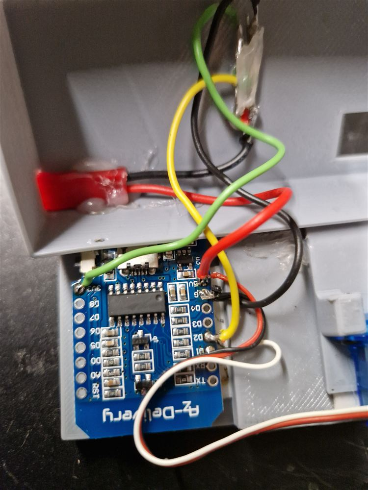 | 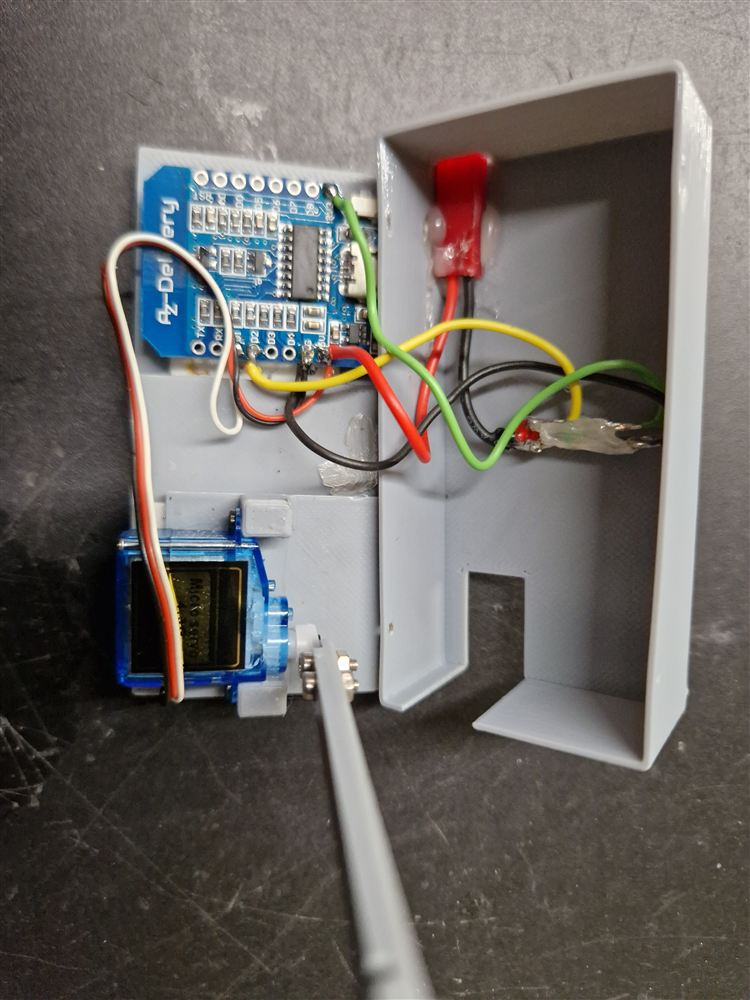 |

Die Fotos in voller Auflösung liegen im Ordner [`Fotos/`](Fotos).

## Teile

| Anzahl | Teil |
|---|---|
| 1 | Wemos D1 mini (ESP8266) – ein ESP32 geht ebenso, dann die YAML anpassen |
| 1 | Micro-Servo, z. B. SG90 |
| 2 | LED 3 mm (rot, grün) mit Vorwiderstand |
| 1 | weiche Feder, Ø 8 mm (für die Tastfläche) |
| – | Alufolie für die Tastfläche |
| – | 3D-Druckteile (siehe unten), kleine Schrauben mit Muttern für die Gelenke |
| 1 | 5-V-Netzteil mit Micro-USB |

## 3D-Druckteile

Alle Teile sind auf [**Printables**](https://www.printables.com/de/model/621586-homeassistant-servo-switch) und hier im Ordner [`3D-Druck/`](3D-Druck):

| Datei | Teil |
|---|---|
| `Back.stl` | Gehäuse-Rückteil |
| `Deckel.stl` | Gehäuse-Deckel |
| `Servo_montage_platte.stl` | Halteplatte für den Servo |
| `Finger_1.stl`, `Finger_2.stl` | die beiden Glieder des Arms |
| `Tastfläche.stl` | Fingerkuppe (Tastfläche, wird mit Alufolie bezogen) |
| `Servoswitch_0.15mm_PLA_MK3_2h14m.gcode` | fertig geslicte Druckdatei für die Prusa MK3 (PLA, 0,15 mm, ca. 2 h 14 min) |
| `WP_Switch v2.f3d` | Konstruktion für Fusion 360 – zum Anpassen an andere Geräte |

## Verdrahtung

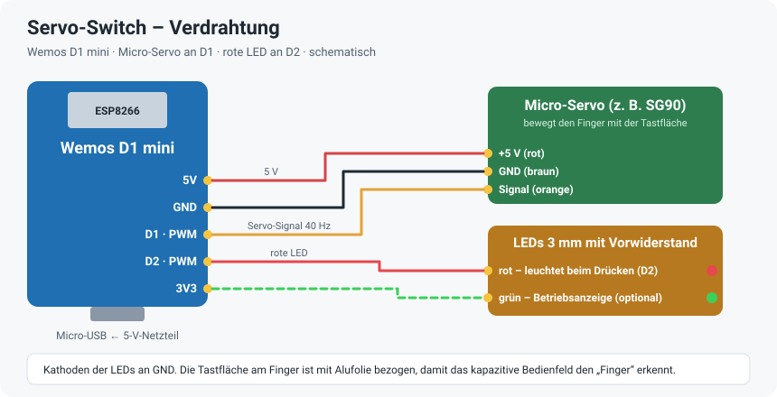

| D1 mini | Anschluss |
|---|---|
| 5V | Servo +5 V (rot) |
| GND | Servo GND (braun), Kathoden der LEDs |
| D1 | Servo-Signal (orange), PWM 40 Hz |
| D2 | rote LED (über Vorwiderstand) |
| 3V3 | grüne LED als Betriebsanzeige (optional, in der YAML nicht angesteuert) |

## Ablauf

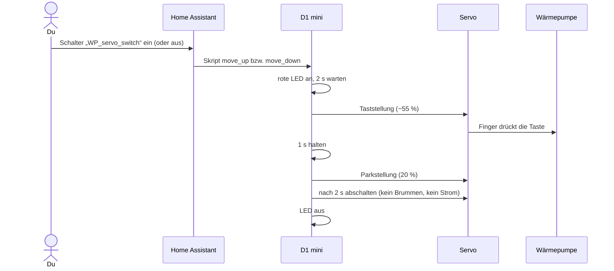

Die Taste an der Wärmepumpe schaltet um – deshalb drücken **Ein** und **Aus** gleich. Der Schalter in Home Assistant verhält sich damit wie ein Taster.

## Installation

1. Druckteile drucken und zusammenbauen, Servo und LEDs nach dem Plan oben anschließen.
2. `wp-servo.yaml` in den ESPHome-Ordner kopieren.
3. Die Zeilen aus `secrets.yaml.example` in die eigene `secrets.yaml` übernehmen und eigene Werte eintragen.
4. Feste IP unter `wifi: manual_ip:` anpassen oder den Block entfernen.
5. Beim ersten Mal per USB flashen, danach per OTA.
6. In Home Assistant hinzufügen (Einstellungen → Geräte & Dienste → ESPHome).

### Einstellen

Oben in der YAML stehen unter `substitutions` die Stellungen des Servos:

| Wert | Bedeutung |
|---|---|
| `up_position: -55%` | Taststellung – so weit, dass die Tastfläche sicher aufliegt |
| `down_position: 20%` | Parkstellung – Finger weg vom Display |
| `frequenz: 40 Hz` | PWM-Frequenz des Servos |

Am besten mit kleinen Schritten an die richtige Taststellung herantasten; die Feder in der Tastfläche gleicht etwas Spiel aus.

## Weiterentwicklung

Die aktuelle Version mit **Rückmeldung** liegt als [BWWP-Steuerung](https://github.com/ossilampe/ESP-Home-Projekte/tree/main/BWWP-Steuerung) im Repository ESP-Home-Projekte: Ein Helligkeitssensor liest dort zusätzlich die Status-LED der Wärmepumpe aus, und Tastweg und Tastdauer lassen sich direkt in Home Assistant einstellen.

## Dateien

```
wp-servo.yaml          ESPHome-Konfiguration
secrets.yaml.example   Vorlage für secrets.yaml (nicht ins Repo!)
3D-Druck/              STL-Dateien, G-Code und Fusion-360-Konstruktion
docs/                  Bilder für diese Seite und Verdrahtungsplan
Fotos/                 Fotos in voller Auflösung
```
